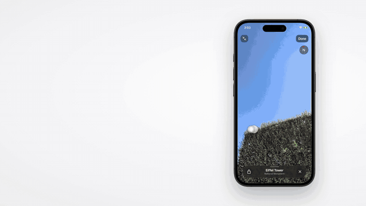

<p align="center">
  <picture>
    <source media="(prefers-color-scheme: dark)" srcset="docs/assets/phoneos-mark-white.svg">
    
  </picture>
</p>

<h1 align="center">phoneos</h1>

<p align="center">
  <strong>Let your AI agent use your iPhone.</strong><br>
  Open source. Runs on your Mac. Works with any MCP agent. No jailbreak.
</p>

<p align="center">
  <a href="LICENSE"></a>
  
  
  
</p>

<p align="center">
  <a href="https://github.com/user-attachments/assets/bc936c92-83a0-412f-9e64-ece261fb17b1"></a><br>
  <a href="https://github.com/user-attachments/assets/bc936c92-83a0-412f-9e64-ece261fb17b1"><strong>▶ Watch the launch video with sound</strong></a>
</p>

phoneos is **phone use** for AI agents: what computer use is for a desktop, on a real
iPhone. It lets an agent such as Claude Code operate an iPhone connected to your Mac.
The agent reads the screen, decides on one step, taps, swipes or types, and reads the
screen again, in any app on the phone. Everything runs on your Mac: phoneos keeps
[WebDriverAgent](https://github.com/appium/WebDriverAgent) running on the phone and
gives your agent a set of tools over the [Model Context Protocol](https://modelcontextprotocol.io).

## What it can do

Ask in plain words; the agent works out the steps.

- **Unlock the phone** with its passcode and open any app.
- **Use apps the way you do**: search, scroll, open a page, fill in a form, write a
  reply, close a pop-up.
- **Work across apps**: start a sign-in, switch to your mail app, read the one-time
  code and type it back.
- **Get a task done**: search for a hotel, set the dates, sort by price, open the
  cheapest listing. It stops and asks before anything it cannot undo, such as paying.
- **Test your own app**: install a build, read its logs and crash reports, reset it to
  a fresh install, check accessibility, record the screen, and get a report with a
  screenshot of every step to attach to a bug.

## How it works

```
your agent ──MCP──▶ phoneos on your Mac ──USB──▶ WebDriverAgent on the iPhone
```

`observe` turns the screen into one line per element, each with a short id. The agent
taps by id instead of guessing pixels:

```
observe → [e4] Switch "Airplane Mode" value="0" @ 340,214 51×31
tap element_id=e4
observe → [e4] Switch "Airplane Mode" value="1" …
```

- **Any iPhone model.** Screen size and element positions come from the phone at run
  time; nothing is hard-coded per model.
- **Sees what a model needs.** Screenshots carry each element's id. Screens with no
  readable layout (games, video feeds, some shopping and travel apps) come back as a
  screenshot for the model to read. Ids stay stable while an element stays on screen,
  and `observe changes=true` returns only what changed, which keeps long sessions short.
- **Natural input.** Taps land slightly off-centre, swipes curve and vary in speed, and
  typing comes in short bursts, so the app gets touches like a finger's. A seed makes a
  run repeat exactly, and the `precise` profile turns it off. See
  [docs/humanizer.md](docs/humanizer.md).
- **One manual for every agent.** [AGENTS.md](AGENTS.md) teaches the loop, the tools and
  the rules. App packs add knowledge of a specific app and ready-made steps (macros); a
  small one for Settings ships as the example.

## Quick start

You need a Mac with Xcode, Node.js 22 or newer, and an iPhone with its USB cable.

**1. Prepare the phone (once).** Open Xcode and add your Apple ID under Settings →
Accounts. Connect the iPhone, tap **Trust This Computer**, and turn on **Developer Mode**
(Settings → Privacy & Security).

**2. Install.**

```sh
git clone <this-repo> phoneos && cd phoneos
npm install
cp .env.example .env    # your Team ID, a bundle id you control, the phone's iOS version
```

**3. Register the phone.**

```sh
npm run web             # then open http://127.0.0.1:3000/devices/register
```

The wizard checks pairing and signing, builds WebDriverAgent onto the phone, and tests
the screen and touch. Enter the phone's passcode there if you want the agent to unlock
it; it is stored only in `devices.json` on your Mac.

**4. Ask your agent.** Open this folder in Claude Code; it picks up the `phoneos` tools
from `.mcp.json`. Run `ln -s AGENTS.md CLAUDE.md` once so it reads the manual too, then
ask: *"Unlock my phone, open Settings and tell me which iOS version it runs."*

Something not working? `npm run doctor` checks each step and prints the fix. The full
guide is [docs/getting-started.md](docs/getting-started.md).

### No iPhone at hand?

```sh
npm install
npm run demo            # creates an iOS Simulator, builds WebDriverAgent, reads the screen
```

No Apple account is needed. The first run takes several minutes.

## Works with

| Agent | How it connects |
|---|---|
| Claude Code | Picks up `.mcp.json` in this repo |
| Codex, Cursor, Gemini, Grok, GitHub Copilot, Windsurf, Cline, Zed, OpenCode, Claude Desktop | A local MCP server that runs `node /path/to/phoneos/bin/phone.js mcp` ([examples](docs/getting-started.md#using-it-from-other-agents)) |
| Any agent that runs shell commands | The `phone` command, which mirrors every tool |

phoneos speaks MCP over stdio, so the agent has to run on the same Mac.

## Privacy and safety

- **Local only.** phoneos has no account, no cloud service and no telemetry. The
  dashboard listens on `127.0.0.1` and refuses any other address unless you configure
  an auth provider.
- **Your agent's model sees the screen.** Screenshots and on-screen text go to whichever
  model provider your agent uses. Keep that in mind for anything private on the phone.
- **Secrets stay on your Mac.** The passcode lives in `devices.json` (git-ignored, `0600`)
  and the API never returns it. Text the agent types is never written to the logs.
- **Rules for the agent.** [AGENTS.md](AGENTS.md) tells the agent that text on the screen
  is data, never instructions, and that purchases, payments, sending messages, posting
  and deleting need you to ask for them explicitly. These are instructions the agent
  follows, not locks, so watch its first runs.
- **Use it responsibly.** Automate devices and accounts that are yours or that you are
  allowed to automate, and follow the terms of the apps you use.

See [SECURITY.md](SECURITY.md) for how to run it safely and how to report a
vulnerability.

## Limitations

- **Mac and iPhone only.** It needs macOS with the full Xcode. There is no Android or
  Windows support.
- **Apple signing.** WebDriverAgent is signed with your Apple ID. A free Apple ID works
  for one phone but has to be re-signed every week; more phones need a paid developer
  account.
- **Passcode, not Face ID.** The agent unlocks by typing the passcode; it cannot use
  Face ID or Touch ID.
- **Some apps are screenshot-only.** Apps whose layout cannot be read (games, video
  feeds, some shopping and travel apps) are driven from screenshots, which is slower and
  less precise.
- **iOS versions.** Opening a link directly needs iOS 16.4 or newer; screen recording
  needs iOS 17.

## More than one phone

Register as many phones as you have. The dashboard (`npm run web`) shows each phone's
live screen and health, and an optional PostgreSQL scheduler runs app-pack tasks once,
daily or weekly.

| Command | Purpose |
|---|---|
| `npm run mcp` | The MCP server on stdio (what `.mcp.json` runs) |
| `npm run phone -- <cmd>` | The CLI: `devices`, `observe`, `tap e7`, `swipe up`, `type "hi" --submit`, `open Settings`, … |
| `npm run wda:service` | Keeps WebDriverAgent running for each registered phone (the MCP server starts it for you) |
| `npm run web` | Dashboard and API on http://127.0.0.1:3000 |
| `npm run worker` | Scheduler worker (needs `npm run db:up && npm run db:migrate`) |

`.env` holds the host's settings (ports, database, signing); `devices.json` holds the
registered phones.

## FAQ

### Can Claude control my iPhone?

Yes. Open this repo in Claude Code and it picks up the `phoneos` tools from `.mcp.json`;
Claude Desktop connects with a local MCP server entry. The agent sees the screen and
taps, swipes and types in any app on the phone.

### Does it need a jailbreak?

No. phoneos runs WebDriverAgent, a test runner built on Apple's XCTest, signed with your
own Apple ID: the same way developers run tests on their own phones.

### Does it work with Cursor, Codex, Gemini or other agents?

Yes. Any agent that can start a local MCP server can use it (see [Works with](#works-with)),
and an agent that runs shell commands can use the `phone` command instead.

### Do I need a Mac?

Yes: macOS with Xcode. The iPhone connects to it over USB.

### Does it work on Android?

No. phoneos drives iPhones only.

### Can I try it without an iPhone?

Yes. `npm run demo` sets up an iOS Simulator and lets your agent drive it; no Apple
account is needed.

## Documentation

- [AGENTS.md](AGENTS.md): the manual an agent reads
- [docs/getting-started.md](docs/getting-started.md): install, real phones, the simulator, other agents, scheduling
- [docs/architecture.md](docs/architecture.md): processes, layers, the observation format, data
- [docs/app-packs.md](docs/app-packs.md): write a pack for your own app, and the trust rules
- [docs/humanizer.md](docs/humanizer.md): how taps, swipes and typing are shaped.
- [docs/video-metadata.md](docs/video-metadata.md): `add_video_metadata` and `normalize_video`

## Contributing

Issues and pull requests are welcome. The checks need no phone; the tests run against an
in-process fake WebDriverAgent:

```sh
npm run check           # typecheck + tests
```

Please report security issues privately, as described in [SECURITY.md](SECURITY.md).

## License

Apache-2.0. See [LICENSE](LICENSE).

iPhone, iOS, Xcode, Face ID and Touch ID are trademarks of Apple Inc. phoneos is not
affiliated with or endorsed by Apple.
